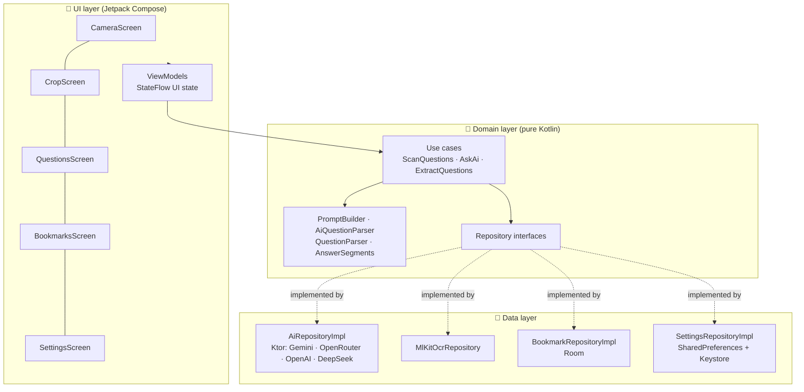
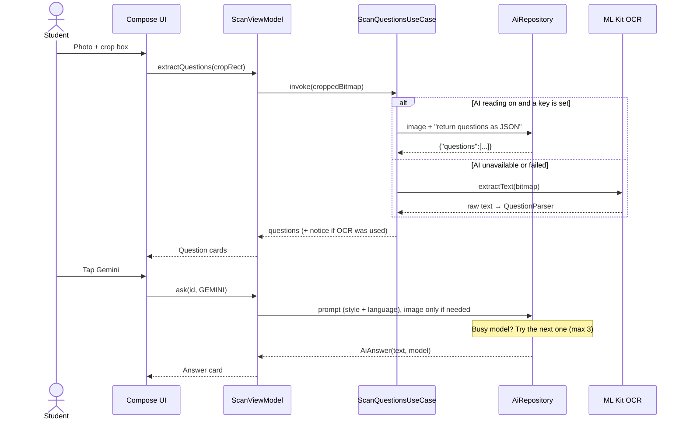

# StudyBuddy AI 📚🤖

**Snap a textbook question, select it, get a clear answer, in English or বাংলা.**

An Android app that turns a photo of a textbook or exam page into short, student-friendly answers
using free AI models. Built with **Kotlin, Jetpack Compose and Clean Architecture**.


-3DDC84?logo=android&logoColor=white)


---

## 📌 At a glance

| | |
|---|---|
| **What** | Android app: photo of a question → AI reads it → short, clear answer |
| **For** | School, college and university students, especially Bangla-medium students |
| **Role** | Solo project: design, architecture, implementation and testing |
| **Stack** | Kotlin · Jetpack Compose · Material 3 · Koin · Ktor · CameraX · ML Kit · Room · Coroutines/Flow |
| **AI** | Google Gemini and OpenRouter (free models), with vision input and automatic model fallback |
| **Architecture** | Clean Architecture (domain / data / UI) + MVVM, unidirectional data flow with `StateFlow` |

---

## 🎯 The problem

When a student gets stuck on a question in a book, getting help from an AI is clumsier than it should be:

- **Typing it out is slow.** Long questions with four MCQ options take a minute or more to type, and typos change the meaning.
- **Uploading a whole page wastes effort.** The AI often answers the wrong question, and every request uses more tokens and more of the free quota.
- **Local content is poorly supported.** Many students in Bangladesh study in **Bangla**, and textbooks are full of **math, formulas and diagrams**. Typical on-device OCR handles none of these.
- **AI answers are often too long.** A student revising for an exam wants `Ans: a. Dhaka` and one line of why, not five paragraphs.

## 💡 The solution

StudyBuddy AI reduces this to **snap → select → tap**:

1. 📷 **Take a photo** of the page, or pick one from the gallery.
2. ✂️ **Drag a box** around just the question(s) you need.
3. 🔍 **The AI reads the photo** and turns it into editable question cards. It handles Bangla, math and figures, and on-device OCR works as an offline fallback.
4. 🤖 **Tap an AI** to get a short, exam-style answer.
5. 🔁 **Ask a follow-up** (*Simpler*, *Example*, *More detail*), switch the language, or **save** the answer for revision.

```
┌──────────────────────────────────────────────────────┐
│ [MCQ]                                         ✎  🗑  │
│ Q. What is the capital of Bangladesh?                │
│ a. Dhaka   b. Rajshahi   c. Chittagong   d. Sylhet   │
├──────────────────────────────────────────────────────┤
│        (G) Gemini              (O) OpenRouter        │
├──────────────────────────────────────────────────────┤
│ [Answer] [Simpler] [Example] [More detail]           │
│ Ans: a. Dhaka                                        │
│ Why: Dhaka is the capital and largest city of        │
│      Bangladesh.                                     │
│ Gemini · Gemini 3.8 Flash               🔖  📋  🔄   │
└──────────────────────────────────────────────────────┘
```

<!--
## 📱 Screenshots
Add real screenshots to docs/screenshots/ and uncomment:

| Camera | Select question | Answer | Saved answers |
|---|---|---|---|
|  |  |  |  |
-->

---

## ✨ Features

### For students
| Feature | What it does |
|---|---|
| 📷 **Camera and gallery** | CameraX capture with runtime permission handling, or the Android Photo Picker (no storage permission needed) |
| ✂️ **Select the question** | Custom drag-to-resize crop box with rotate and "select whole page" |
| 🔍 **AI photo reading** | A vision model reads the cropped photo and returns structured questions. Works with **Bangla, math and diagrams** |
| 🔤 **Offline OCR fallback** | Google ML Kit on-device text recognition (English) when AI reading is off or unavailable |
| ✎ **Editable questions** | Fix recognition mistakes, add or remove MCQ options, or type a question by hand |
| 🎯 **Answers that fit the question** | MCQ → `Ans:` + one-line `Why:` · written question → 80–150 words with key points · coding question → a complete, working program |
| 🔁 **Follow-ups** | *Simpler*, *Example* and *More detail* versions of every answer, each cached so switching is instant |
| 🌐 **Answer language** | English, বাংলা, or both |
| 🔖 **Saved answers** | Bookmark answers into a local database for exam revision |
| 💻 **Code-friendly answers** | Programs shown in a monospace block. Copy gives clean code, ready to paste into an editor |

### Under the hood
| Feature | What it does |
|---|---|
| 🔄 **Automatic model fallback** | If a free model is busy (429), retired (404) or down (5xx), the next model is tried automatically, up to 3 |
| 🖼️ **Figure-aware answering** | When a question refers to a diagram, the photo is sent along with it; otherwise only text is sent, which saves quota |
| 🔐 **Encrypted API keys** | Keys are encrypted with an AES-256-GCM key held in the **Android Keystore**; older plain-text keys are migrated automatically |
| 🛡️ **No secrets in release builds** | Developer keys from `local.properties` are compiled into **debug builds only** |
| ⚠️ **Clear error messages** | Missing key, no API credit, rate limit, network failure: each gets a clear message and a fix |
| 🧩 **Pluggable AI providers** | ChatGPT and DeepSeek are fully implemented but hidden behind a flag until paid API access is set up |

---

## 🏗️ Architecture

The app follows **Clean Architecture** with **MVVM**. The domain layer is plain Kotlin with no
Android UI or network code, so business rules (prompting, parsing, fallback decisions) are easy to
test and providers can be swapped without touching the UI.



### How a scan becomes an answer



### Project structure

```
app/src/main/java/com/example/aistuddybuddy/
├── di/                        Koin modules (app, repository, use case, view model)
├── domain/                    Pure business logic
│   ├── model/                 Question, AiProvider/AiModel, AiAnswer, AnswerStyle, Bookmark, errors
│   ├── parser/                PromptBuilder, AiQuestionParser (JSON), QuestionParser (OCR text), AnswerSegments
│   ├── repository/            AiRepository, OcrRepository, SettingsRepository, BookmarkRepository
│   └── usecase/               ScanQuestions, AskAi, ExtractQuestions, ProcessOcrImage
├── data/
│   ├── ai/                    Ktor clients for each provider, DTOs, fallback logic
│   ├── bookmarks/             Room entity, DAO, database
│   ├── ocr/                   ML Kit text recognition
│   ├── image/                 Gallery image decoding
│   └── settings/              Preferences + KeyCipher (Android Keystore encryption)
├── ui/
│   ├── navigation/            Navigation Compose host and routes
│   ├── screens/               camera · crop · questions · bookmarks · settings
│   ├── components/            Shared composables
│   └── theme/                 Material 3 theme
└── util/                      Bitmap and camera helpers
```

---

## 🧠 Engineering highlights

Some of the more interesting problems and how they were solved:

**1. Getting past OCR limits with vision models.**
ML Kit's on-device recognizer only reads Latin script, so Bangla questions came out as garbage, and
math and diagrams were lost. The app now sends the cropped image to a vision model with a strict
prompt that returns JSON (`text`, `options`, `needsFigure`). `AiQuestionParser` reads the JSON even
when the model wraps it in code fences or extra text. OCR is kept as an offline fallback.

**2. Reliable answers from free models.**
Free models are often busy or get retired. `AiRepositoryImpl` sorts each failure into *retryable*
(429, 404, 5xx) or *final* (bad key, no credit), and moves to the next suitable model only when
retrying can help. When a photo is attached, it only tries models marked as image-capable. The UI
shows which model actually answered.

**3. Keeping code intact in answers.**
A markdown cleanup step was stripping `#include` and `**` from C programs. `AnswerSegments` now
splits answers into prose and code blocks, so cleanup only touches prose. The UI shows code in
monospace, and copying removes the ``` markers.

**4. Prompts as testable domain logic.**
`PromptBuilder` creates prompts based on question type (MCQ or written), follow-up style, answer
language and whether a figure is attached. That keeps answers short and consistently formatted, and
lets the UI bold labels like `Ans:` and `Why:`.

**5. Secure key storage without extra dependencies.**
`KeyCipher` uses an AES-256-GCM key generated inside the Android Keystore, so the raw key never
leaves secure hardware where the device supports it. Keys saved by older versions are encrypted the
first time they're loaded.

**6. State management.**
One activity-scoped `ScanViewModel` holds immutable UI state in a `StateFlow`. Answers are cached
per *(AI, follow-up style)*, and in-flight requests are tracked so deleting a question cancels its
network calls.

---

## 🛠️ Tech stack

| Area | Technology |
|---|---|
| Language | Kotlin 2.1, Coroutines, Flow |
| UI | Jetpack Compose, Material 3, Navigation Compose |
| Architecture | Clean Architecture, MVVM, Repository and Use Case patterns |
| Dependency injection | Koin 4 |
| Networking | Ktor Client 3 (OkHttp engine), kotlinx.serialization |
| AI providers | Google Gemini API, OpenRouter (OpenAI-compatible), with OpenAI and DeepSeek supported |
| Camera | CameraX 1.4 |
| OCR | Google ML Kit Text Recognition (on-device) |
| Local storage | Room (saved answers), SharedPreferences + Android Keystore (settings and keys) |
| Testing | JUnit 4 unit tests for the domain parsers |
| Build | Gradle Kotlin DSL, version catalog, KSP |
| Min / target SDK | 24 / 35 |

---

## 🧪 Testing

```bash
./gradlew :app:testDebugUnitTest
```

Unit tests cover the domain logic that matters most for correctness:

- **`QuestionParserTest`**: splitting OCR text into numbered questions and detecting MCQ options (inline, one per line, `a.` / `(b)` / `C)`)
- **`AiQuestionParserTest`**: reading the vision model's JSON, including code-fenced replies, Bangla text, blank entries and non-JSON replies
- **`AnswerSegmentsTest`**: keeping code blocks verbatim (`#include`, `int **p`), handling unclosed fences and producing clean copy text

---

## 🚀 Getting started

### Requirements
- Android Studio (recent stable version), JDK 11+
- A device or emulator running Android 7.0+ (the gallery option works without a camera)
- A free API key for **Gemini** and/or **OpenRouter**

### Build and run
```bash
git clone https://github.com/sbfrusho/AiStuddyBuddy.git
cd AiStuddyBuddy
./gradlew :app:installDebug        # build and install on a connected device
```

### API keys
Enter keys in the app (**⚙️ Settings**), where they are stored encrypted on the device. For
development, you can also add them to `local.properties` (git-ignored) to preload them in debug builds:

```properties
GEMINI_API_KEY=your-key
OPENROUTER_API_KEY=your-key
```

| AI | Cost | Get a key |
|---|---|---|
| **Gemini** | ✅ Free quota, no card needed | [aistudio.google.com/apikey](https://aistudio.google.com/apikey) |
| **OpenRouter** | ✅ Free `:free` models (daily limit) | [openrouter.ai/settings/keys](https://openrouter.ai/settings/keys) |

> ChatGPT and DeepSeek are implemented but hidden, because their APIs need prepaid credit. To enable
> one, remove `isEnabled = false` from it in `domain/model/AiProvider.kt`.

---

## ⚠️ Known limitations

- **Users bring their own API key.** That's fine for personal use; a public release should route requests through a backend.
- **Offline OCR is English only.** Bangla needs AI reading, which needs an internet connection.
- **Free-model lists change often.** They're kept in `AiProvider.kt`, and Settings has a "Custom model ID" option.
- **MCQ options are labelled a, b, c, d**, even when the book uses ক, খ, গ, ঘ.

## 🗺️ Roadmap

- [ ] **Google sign-in + backend proxy** (Firebase Auth + Cloudflare Worker) so users don't need API keys
- [ ] **Streaming answers** that appear word by word
- [ ] **Math rendering** (LaTeX) for formulas
- [ ] **Follow-up chat** on an answer
- [ ] **Share or export** saved answers as PDF
- [ ] **UI tests** with Compose testing and repository tests with a mock HTTP engine

---

## 👤 Author

**Sakib Bin Faruque Rusho**
Android developer · Kotlin · Jetpack Compose

- GitHub: [@sbfrusho](https://github.com/sbfrusho)
<!-- - LinkedIn: add your profile link here -->

If you have feedback or ideas for improving the app, please
[open an issue](https://github.com/sbfrusho/AiStuddyBuddy/issues). I'd love to hear them.
