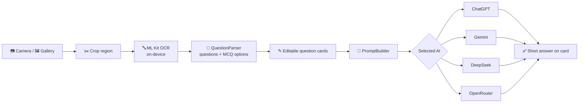

# StudyBuddy AI 📚🤖

**Scan a question from your book, pick an AI, get a clear answer.**

StudyBuddy AI is an Android app for students. When you're stuck on a question in a textbook, you
usually have to type it into ChatGPT / Gemini / DeepSeek by hand, or upload a whole page or PDF,
which is slow and wastes tokens. StudyBuddy instead lets you:

1. 📷 **Take a photo** of the page (or pick one from the gallery)
2. ✂️ **Select only the part** that contains the question(s)
3. 🔤 **Read the questions** — Gemini (or a free OpenRouter vision model) reads the photo, including Bangla, math and figures; on-device ML Kit OCR is the offline fallback
4. 🤖 **Tap an AI** — Gemini or OpenRouter (ChatGPT and DeepSeek are built in but hidden until paid API access is set up)
5. ✅ **Get a short, easy-to-understand answer** — `Ans: a. Dhaka` for MCQs, a concise explanation for descriptive questions

```
┌──────────────────────────────────────────────────────┐
│ [MCQ]                                         ✎  🗑  │
│ Q. What is the capital of Bangladesh?                │
│ a. Dhaka   b. Rajshahi   c. Chittagong   d. Sylhet   │
├──────────────────────────────────────────────────────┤
│   (C)        (G)        (D)          (O)             │
│ ChatGPT    Gemini    DeepSeek    OpenRouter          │
├──────────────────────────────────────────────────────┤
│ Ans: a. Dhaka                                        │
│ Why: Dhaka is the capital and largest city of        │
│      Bangladesh.                        📋  🔄        │
└──────────────────────────────────────────────────────┘
```

> 📖 **Full technical documentation** — architecture, design patterns, why Ktor, navigation,
> every important function and pipeline diagrams — is in
> **[docs/PROJECT_GUIDE.md](docs/PROJECT_GUIDE.md)**.

---

## Features

| Feature | Details |
|---|---|
| Camera capture | CameraX preview + still capture, with runtime permission handling |
| Gallery import | Android Photo Picker (no storage permission needed) |
| Region selection | Custom drag-to-resize crop box with rotate and "select whole page" |
| AI photo reading | The cropped photo goes to a vision model that returns the questions as JSON — Bangla, math and figures included |
| On-device OCR | Google ML Kit Text Recognition — free, offline, English only; used when AI reading is off or fails |
| Question parsing | Splits numbered questions (`1.`, `2)`, `Q.`, `Q3`, `Question 4`) and detects MCQ options (`a.`, `(b)`, `C)`, inline or one per line) |
| Editable questions | Fix OCR mistakes, add/remove options, or type a question manually |
| Multiple AIs | Gemini and OpenRouter — answers kept per AI so you can compare |
| Model fallback | If a free model is busy or retired, the next model is tried automatically (up to 3) |
| Follow-ups | Simpler / Example / More detail versions of every answer |
| Answer language | English, বাংলা, or both |
| Saved answers | Bookmark answers into a local Room database for revision |
| Model picker | Dropdown per AI with verified model IDs, plus a custom model ID option |
| Tuned answers | MCQ → `Ans:` + one-line `Why:`; descriptive → ~80–150 words with bullet points |
| Friendly errors | Explains missing keys, no API credit, rate limits, network errors |
| Key security | API keys encrypted with the Android Keystore; `local.properties` keys only in debug builds |

---

## Tech stack

| Area | Library |
|---|---|
| Language | Kotlin 2.1 |
| UI | Jetpack Compose + Material 3 |
| Architecture | Clean Architecture + MVVM |
| Dependency injection | Koin 4 |
| Networking | Ktor Client 3 (OkHttp engine) + kotlinx.serialization |
| Navigation | Jetpack Navigation Compose 2.8 |
| Camera | CameraX 1.4 |
| OCR | ML Kit Text Recognition (bundled, Latin script) |
| Permissions | Accompanist Permissions |
| Async | Kotlin Coroutines + StateFlow |
| Min / target SDK | 24 / 35 |

---

## Getting started

### Requirements
- Android Studio (recent stable version)
- JDK 11+
- A device or emulator with a camera (Android 7.0+). The gallery option works without one.

### Build & run
```bash
git clone https://github.com/sbfrusho/AiStuddyBuddy.git
cd AiStuddyBuddy
./gradlew :app:assembleDebug        # build the APK
./gradlew :app:installDebug         # install on a connected device
./gradlew :app:testDebugUnitTest    # run unit tests
```

### API keys

You need a key for at least one AI. Keys can be entered **in the app** (⚙️ Settings) or put in
`local.properties` (git-ignored) so they're preloaded in debug builds:

```properties
GEMINI_API_KEY=your-key
OPENROUTER_API_KEY=your-key
OPENAI_API_KEY=your-key
DEEPSEEK_API_KEY=your-key
```

Keys entered in Settings take priority over `local.properties`.

| AI | Free? | Get a key |
|---|---|---|
| **Gemini** | ✅ Free quota, no card needed | [aistudio.google.com/apikey](https://aistudio.google.com/apikey) |
| **OpenRouter** | ✅ Free `:free` models (daily limit) | [openrouter.ai/settings/keys](https://openrouter.ai/settings/keys) |
| ChatGPT (OpenAI) | ❌ Prepaid API credit required | [platform.openai.com/api-keys](https://platform.openai.com/api-keys) |
| DeepSeek | ❌ Prepaid API balance required | [platform.deepseek.com/api_keys](https://platform.deepseek.com/api_keys) |

> ⚠️ A ChatGPT Plus subscription or the free DeepSeek app does **not** include API usage.
> If you see *"no credit"* errors, use Gemini or OpenRouter, or top up the API account.

---

## How to use

1. Open the app and allow camera access (or tap 🖼️ to pick a photo).
2. Fit the page in view and tap the shutter.
3. Drag the box around the question **and its options**. You can include several questions.
4. Tap **Extract questions**.
5. Check the question — tap ✎ to fix any OCR mistakes.
6. Tap an AI button. The answer appears below; tap 📋 to copy or 🔄 to ask again.
7. Tap **Scan more** to add questions from another page. New ones appear at the top.

---

## Project structure

```
app/src/main/java/com/example/aistuddybuddy/
├── AiStudyBuddy.kt            Application class — starts Koin
├── MainActivity.kt            Single activity — hosts Compose + navigation
├── di/                        Koin modules (app, repository, use case, view model)
├── domain/                    Pure business logic (no UI, no network details)
│   ├── model/                 Question, AiProvider, AiModel, errors
│   ├── parser/                QuestionParser (OCR text → questions), PromptBuilder
│   ├── repository/            Interfaces: OcrRepository, AiRepository, SettingsRepository
│   └── usecase/               ExtractQuestions, ProcessOcrImage, AskAi
├── data/                      Implementations of the domain interfaces
│   ├── ai/                    Ktor calls to OpenAI / Gemini / DeepSeek / OpenRouter + DTOs
│   ├── ocr/                   ML Kit text recognition
│   ├── image/                 Gallery image decoding
│   └── settings/              API keys & model choice (SharedPreferences)
├── ui/
│   ├── navigation/            NavHost and routes
│   ├── screens/camera/        Camera preview, capture, permission UI
│   ├── screens/crop/          Crop box + crop screen
│   ├── screens/questions/     Question cards, list screen, ScanViewModel
│   ├── screens/settings/      Keys + model dropdowns, SettingsViewModel
│   ├── components/            ProviderBadge
│   └── theme/                 Material 3 theme
└── util/                      Camera & Bitmap helper extensions
```

---

## Pipeline at a glance



More detailed diagrams (layers, sequence, navigation) are in
[docs/PROJECT_GUIDE.md](docs/PROJECT_GUIDE.md#9-pipeline-diagrams).

---

## Known limitations
- **Bangla text isn't recognized** — ML Kit's on-device recognizer supports Latin script (English), not Bengali.
- **API keys are stored on the device** in plain app storage. Fine for personal use; a published app should call the AIs through a backend.
- **Question history isn't saved yet** — Room is included as a dependency for this future feature.
- **Model lists change** — update them in `domain/model/AiProvider.kt`, or use "Custom model ID" in Settings.

## Roadmap
- [ ] Save questions & answers with Room (history screen)
- [ ] Bangla OCR support
- [ ] Backend proxy for API keys
- [ ] Ask follow-up questions on an answer
- [ ] Share / export answers as PDF

## Author
**Sakib Bin Faruque Rusho** — [@sbfrusho](https://github.com/sbfrusho)
